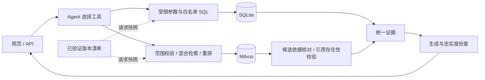
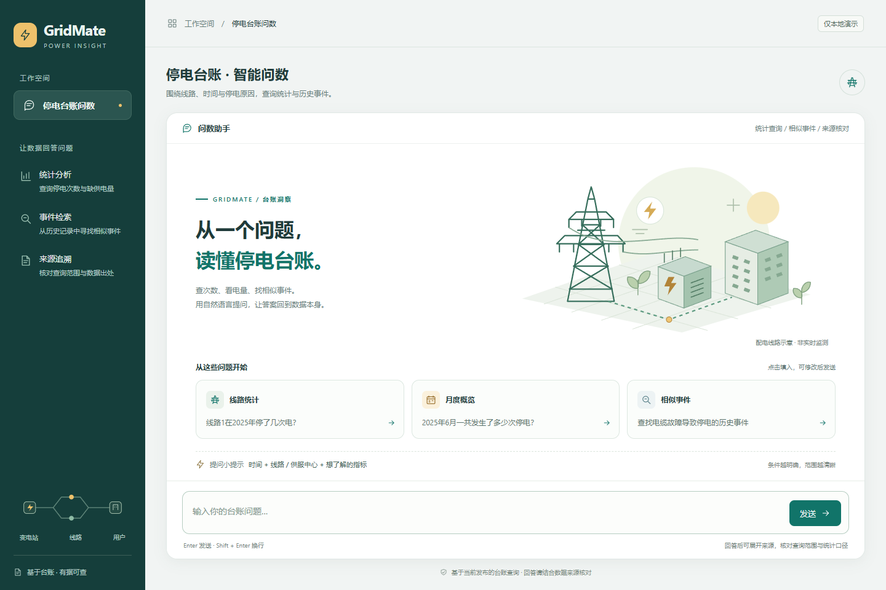
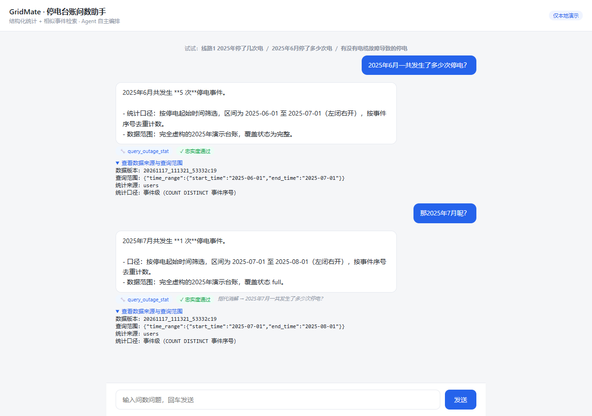

# GridMate · 停电台账问数助手

面向停电台账的应用开发项目：自然语言统计、历史事件检索、多轮追问和证据展示。重点是统计口径、筛选范围、跨库数据版本与回答溯源。当前定位为本地演示原型。

## 能力与实现

| 能力 | 实现 | 边界 |
| --- | --- | --- |
| 统计问数 | 模型提取有限意图参数，4个白名单模板执行参数化 SQL | 参数识别仍可能出错，不支持任意 SQL |
| 统计粒度 | 停电次数按事件去重；缺供电量在用户行求和 | 不把多表直接 JOIN 后的行当作独立事件 |
| 事件检索 | 事件级语料，Dense + BM25混合召回、重排、原文依据核对 | 只展示模型判有支持且引用存在的案例；核对仍可能误判，分数不是概率 |
| 范围约束 | 从用户行计算符合条件的事件集合，检索前过滤 | 时间按记录开始时刻，区间左闭右开；非任意重叠区间 |
| 证据输出 | 数据版本、查询范围、统计来源、事件与原始行 ID | 引用对齐不等于回答每句话都正确 |
| 发布与回滚 | 独立 SQLite/JSONL/Milvus 版本，校验后切换清单，请求固定快照 | 旧版本暂不自动清理 |
| 多轮与自检 | 会话指代消解、忠实度检查、失败降级展示工具数据 | 模型自检不是人工事实审核；会话目前保存在进程内 |



## 快速验证（不需要业务数据和密钥）

Python >= 3.10；建议使用 uv。项目根目录执行：

```sh
uv sync --locked --dev
uv run --locked pytest -q
```

测试使用虚构台账，并阻止外部网络调用。本次本地验证为 **99 passed**；这不是线上全部场景可用率。

## 启动演示

在单独的演示副本中执行。需要可用的 Milvus 服务（支持 BM25 Function 和中文分析器），以及支持工具调用/结构化输出的聊天模型、1024维 Embedding 和 `/rerank` 服务。Milvus 安装参见 [官方文档](https://milvus.io/docs/install_standalone-docker-compose.md)。

1. 复制 `.env.example` 为 `.env`，填写本机服务配置。不要提交 `.env`。
2. 生成完全虚构的演示数据，目录必须尚不存在：

```sh
uv run --locked python -m scripts.make_demo_data --output data/demo_source
```

3. 发布演示数据。会调用 Embedding 服务，并把**该副本**当前版本切到合成数据：

```sh
uv run --locked python -m scripts.query.publish --source-dir data/demo_source --coverage-basis "完全虚构的2025年演示台账"
uv run --locked uvicorn app.main:app --host 127.0.0.1 --port 8100
```

打开 http://127.0.0.1:8100 。本项目未实现账号鉴权、租户隔离和生产运维流程，当前按本地演示部署。

合成数据有6个事件、8条用户行。可问“线路1 2025年6月停了几次电”（2次），“2025年6月共停电几次”（5次），再追问“那7月呢”（1次）。这些数字仅用于检查流程，不是业务评测成绩。

业务台账 CSV、原文标注、实际问答和密钥不随代码提供。真实资料做了假名化处理，但自由文本仍可能包含可识别信息；对外演示优先使用合成数据。

## 验证与评测

| 层次 | 截至2026-11-17的结果 | 如何解读 |
| --- | --- | --- |
| 离线工程回归 | 99/99通过 | 合成数据覆盖发布、过滤、证据核对、会话和失败分支 |
| 浏览器验收 | 12项通过，其中4项真实模型调用 | Edge桌面/移动视口；其余含注入响应的交互和异常检查 |
| 真实固定检索v3 | 8项场景预期通过 | 原v2为6通过/1失败/1待确认；v3修订1题为依据不足，不直接比较通过率 |
| 当前候选核对 | 21个位置：保留18个正例、拦下1个负例、单列2个歧义 | 依据AI初审标签，不是人工金标准；两条歧义未确认为正例或负例 |
| 合成核对样例 | 12条开发与12条验证均通过 | 真实模型调用，AI编写样例，不代表业务泛化效果 |
| 本轮定点验收 | 真实网页3项、统计与检索组合API 1项通过 | 验证窄范围拒绝、歧义提示和正常正例保留 |

同日补验收还完成真实回滚11项、复杂筛选/恢复/会话9项，以及Edge/Firefox各4项故障显示测试。发现并修复半轮历史、锁积累、长对话实体丢失和降级分支问题；业务生成曾触发真实降级，保留失败记录，补清证据后复测通过。详见补验收文档。

同日相关性修复增加原文依据核对：缺少支持的候选不再展示，不为凑数放宽范围。旧失败报告保留；新版题集仅将已标负例所在的R1从“必须命中”改为“依据不足”，不修改负例标签，评测器将新旧配置标为不可直接比较。8项通过是场景验收，不能称为检索准确率100%。详见[相关性修复与面试复盘](docs/相关性收尾与数据质量处理-2026-11-17.md)。

浏览器验收（另一个终端先启动服务）：

```sh
uv sync --locked --dev --extra browser
uv run --locked python -m scripts.accept_browser --url http://127.0.0.1:8100
# 加 --live 才实际调用模型；默认只测注入响应的界面交互。
# Windows默认使用已安装的Edge；其他环境可安装Chromium后加 --channel chromium。
```

真实固定检索使用本地业务版本及其标注，不适用于合成演示集：

```sh
uv run --locked python -m scripts.query.eval_fixed_set --labels <本地补审标签.json> --set-version fixed-set-v3
```

退出码：0全部通过，1至少一项失败，2无失败但仍有未验证项。补审文件绑定数据版本与语料哈希；标签 `null` 保留歧义。报告保存到 `data/evaluations/`，不会入库。缺少本地标签时不会把未知相关性算作通过。可用 `--set-version fixed-set-v2` 保留旧预期重跑；拒绝已知正例也会判失败。

## 发布与接口

完整发布串行执行建库、语料生成、向量构建及读回校验；成功后切换 `data/masked/version.json`，失败保留旧版本。回滚前重新验证完整产物：

```sh
uv run --locked python -m scripts.query.publish --rollback <已有版本号>
```

| 接口 | 用途 |
| --- | --- |
| `POST /api/ask` | 单轮：`{"query":"...","self_check":true}` |
| `POST /api/chat` | 多轮：`{"session_id":"demo-1","query":"..."}` |
| `DELETE /api/chat/{session_id}` | 清理会话历史 |
| `GET /healthz` | 进程存活检查，不代表外部模型/Milvus都正常 |

当前统计模板：`line_outage_count`、`supply_center_energy`、`time_range_outage_count`、`outage_type_ratio`。占比暂不支持按线路/供服中心筛选和单标签分母重算；不支持的条件应拒绝或说明范围，不能悄悄忽略。

## 页面与合成数据演示

新版欢迎页采用电力主题工作台，提供线路统计、月度概览和相似事件示例入口。下图没有发送问题，不包含台账结果。详见[前端优化与界面验收](docs/前端电力主题优化-2026-11-17.md)。



下图保留优化前的独立合成数据副本真实模型调用记录，非业务台账结果；新版样式检查使用注入响应，不替代这份历史记录。



## 代码入口与演示材料

- [零基础源码阅读指南](docs/零基础源码阅读指南-2026-11-17.md)：原源码已加入中文学习注释，按统计、模型解析、检索、Agent的顺序阅读。
- `app/core/agent.py`：工具编排与自检；`ask.py` / `query_templates.py`：意图与统计。
- `app/core/scope.py` / `similar.py`：范围与检索；`relevance.py`：候选依据核对；`evidence.py`：证据结构。
- `app/core/versioning.py` / `scripts/query/publish.py`：版本发布与请求快照。
- `tests/`：合成回归；`scripts/accept_browser.py`：可重跑的浏览器验收。
- [5分钟演示与面试问答](docs/演示与面试手册-2026-11-17.md)
- [验证结论与已知限制](docs/验收摘要-2026-11-17.md)
- [现有功能补验收与面试复盘](docs/现有功能补验收与面试复盘-2026-11-17.md)
- [相关性修复、数据质量处理与面试复盘](docs/相关性收尾与数据质量处理-2026-11-17.md)

历史上从通用问答项目改造而来。此版本保留围绕停电台账的核心路径；未接入 Quarry 服务本体，不宣称具备其全部功能。
