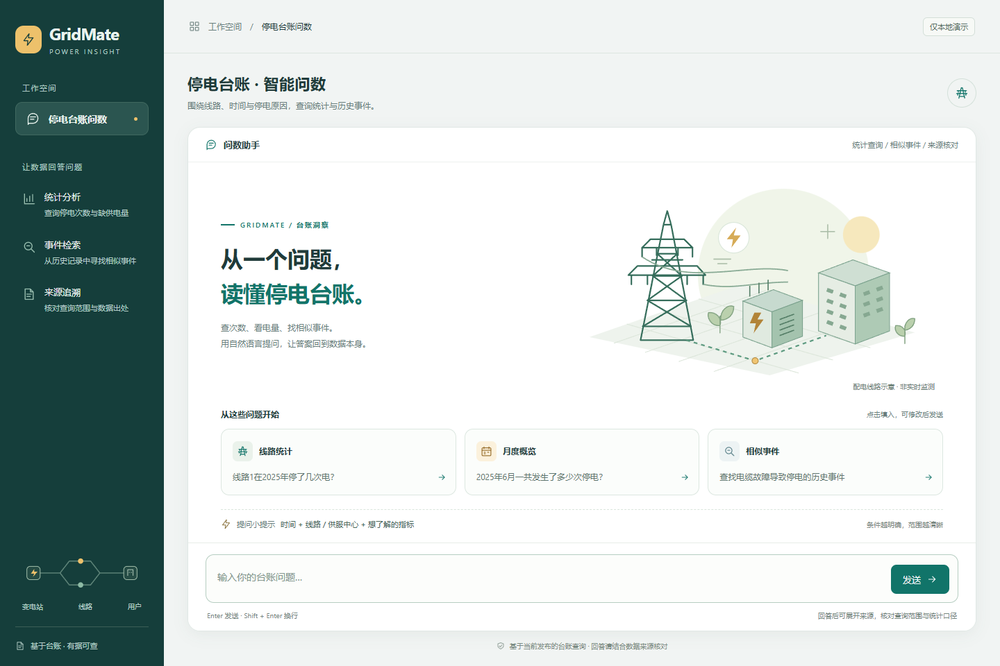

# GridMate 前端电力主题优化

日期：2026-11-17。本轮目标是减少首页空旷感，让现有问数助手更贴近停电台账场景。

## 页面变化

- 深青色侧栏配合浅色工作台，展示统计分析、事件检索、来源追溯三项已有能力。
- 加入本地绘制的铁塔、配电设备、楼宇插画，以及“变电站—线路—用户”关系示意。页面明确标注“非实时监测”。
- 首页提供线路统计、月度概览、相似事件三张问题卡片。点击后只把文本放入输入框，可修改再发送。
- 首次有效发送后移除欢迎区，完整空间用于对话；消息补充身份标签，来源展开区增加层次。
- 输入框随文字增长，最多120px；保留重复提交保护、草稿保护、中文输入法处理、异常后重试。
- 笔记本压缩头图区，手机隐藏侧栏并将示例卡片纵向排列。较小屏幕允许聊天内容滚动，输入区留在工作台底部。

这里的界面不固定展示事件总数、数据版本或停电量。业务副本与合成演示副本使用同一前端，实际答案与来源仍来自各自配置的数据版本。

## 页面预览

以下是欢迎页，尚未发送问题，没有业务记录或模型生成结果。

手机预览：[390px欢迎页](images/ui-power-mobile.png)。旧版合成数据真实模型调用截图仍保留在原文件中，没有用界面测试响应覆盖它。

## 源码怎么读

| 文件 | 用途 |
| --- | --- |
| `app/static/index.html` | 页面结构、示例卡片、输入框、消息和来源展示；脚本仍调用 `/api/chat` |
| `app/static/workspace.css` | 颜色、布局、聊天样式、窄屏与低高度适配；带中文学习注释 |
| `app/static/power-grid.svg` | 电力设备矢量插画；只负责视觉展示 |

先看HTML中 `welcome`、`chat`、`inputbar` 三个容器，再读示例按钮监听、`resizeInput()` 和 `sendMsg()`。后端查询、数据发布、模型配置均未修改。

## 本轮验证

1. 原有8项Edge浏览器检查全部通过：空白/中文组合输入/换行、防重复和草稿保留、HTML转义、HTTP失败、网络失败、失败后恢复、手机布局、无脚本异常。
2. 额外检查三张卡片的键盘填入、首次发问移除欢迎区、来源折叠、长ID换行、多行输入高度。
3. 检查1280×720、1024×768、768×1024、390×844、320×568、844×390视口，未发现整页横向溢出，输入框和发送按钮保持可见。另保存1440×960桌面截图。
4. 通过FastAPI进程内测试客户端验证 `/`、CSS、SVG均返回200及正确内容类型。

本轮对话使用明确标记的合成注入响应，只验证界面交互；真实模型调用次数为0，没有重新评估模型质量。移动端是桌面浏览器的尺寸模拟，尚未验证真机软键盘行为。没有将前端验收当作新的业务准确率。

本地报告与过程截图：`data/evaluations/ui_power_20261117/`（Git忽略）。其中 `browser/browser-results.json` 是原有8项报告，`ui-results.json` 是新增交互/尺寸与源码哈希记录，`static-routes.json` 是资源路径检查。

## 面试可以怎样讲

> 原来的页面只放一个聊天框，首次打开时不清楚可以问什么。我围绕线路统计、月度统计和历史事件检索做了示例入口，用电力设备示意图表达业务场景。示例先填入输入框再由用户发送，来源仍可展开核对。页面没有虚构实时运行数据；统计和检索继续由后端处理。我用注入响应检查输入法、重复提交、失败恢复与来源展示，再按多种屏幕尺寸检查布局。

界面改进用于提升演示清晰度；面试的技术重点仍是统计口径、范围约束、证据追溯与版本一致性。

## 如何看到新版

更新已启动服务所使用的项目目录后，在浏览器按 **Ctrl + F5** 刷新。页面资源由现有FastAPI静态目录提供，不需要安装前端依赖或执行打包。若尚未启动服务，按README已有启动步骤运行；本轮验收脚本中的临时静态服务在检查结束时已关闭。
